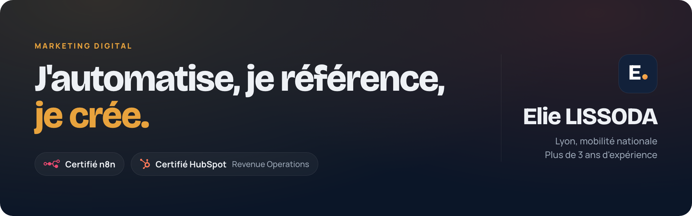
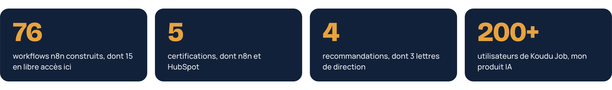
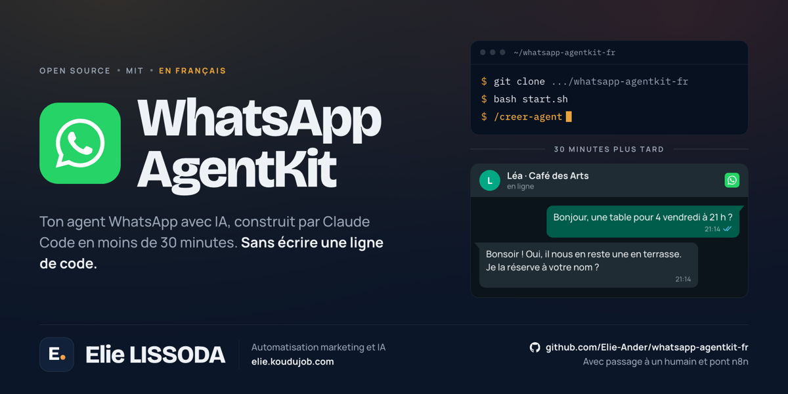
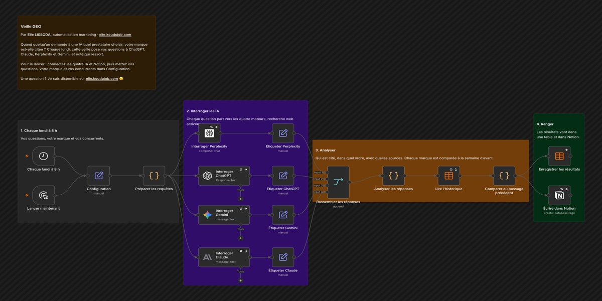
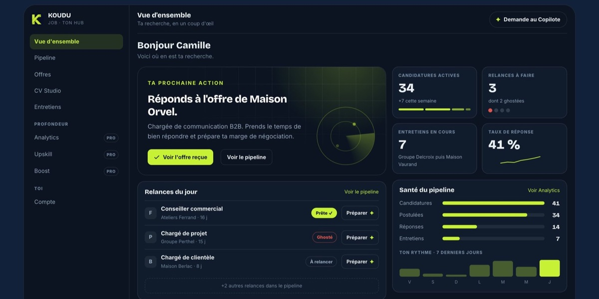

  

  
  
  

Workflows n8n et agents IA, SEO et GEO, création graphique et vidéo : le marketing et la technique réunis dans un seul profil. Je construis ce dont j'ai besoin, en code comme en no-code, et je publie ici ce qui peut servir à d'autres.

##  En chiffres

  

##  Ce que j'ai construit

<table>
  <tr>
    <td width="50%" valign="top">
      
      <h3>WhatsApp AgentKit</h3>
      
Un kit pour Claude Code : il pose 12 questions sur une entreprise, puis écrit et teste son agent WhatsApp. J'y ai ajouté le passage à un humain et le pont vers n8n.

      
<a href="https://github.com/Elie-Ander/whatsapp-agentkit-fr"><b>Voir le dépôt</b></a> · <a href="https://elie-ander.github.io/whatsapp-agentkit-fr/"><b>Voir le site</b></a>

    </td>
    <td width="50%" valign="top">
      
      <h3>Workflows n8n</h3>
      
15 workflows prêts à importer pour le marketing et les ventes : veille GEO, reporting, qualification de leads, relances. Chacun arrive avec ses notes et sa documentation.

      
<a href="https://github.com/Elie-Ander/n8n-workflows"><b>Voir le dépôt</b></a>

    </td>
  </tr>
  <tr>
    <td width="50%" valign="top">
      
      <h3>Koudu Job</h3>
      
Un copilote de recherche d'emploi, conçu, développé et mis en ligne seul. Application web et extension Chrome, dix plateformes connectées, IA de Claude et d'ElevenLabs, paiement Stripe.

      
<a href="https://koudujob.com"><b>Voir koudujob.com</b></a>

    </td>
    <td width="50%" valign="top">
      
      <h3>Portfolio</h3>
      
Mes travaux en marketing digital, automatisation, SEO et GEO, création graphique et vidéo, avec des workflows dont on peut rejouer l'exécution.

      
<a href="https://elie.koudujob.com"><b>Voir elie.koudujob.com</b></a>

    </td>
  </tr>
</table>

##  Ce que je fais

| Automatisation et IA | SEO et GEO | Produit et code |
| :--- | :--- | :--- |
| Workflows qui tournent en production | Trafic organique gagné sur trois sites | Koudu Job, de l'idée à la mise en ligne |
| Agents IA intégrés aux flux métiers | Positionnement sur Google, ChatGPT, Perplexity et Gemini | Applications web et extensions Chrome |
| Connexions par API et webhooks | Audits, contenus et veille GEO automatisés | Applications mobiles avec React Native et Expo |

##  Mes outils

**Automatisation et IA**

**SEO, GEO et data**

**Code**

##  Certifications

- **n8n** : Foundations Professional Certificate
- **HubSpot Academy** : Revenue Operations

Cinq certifications en tout. Le détail, avec mon parcours et mes recommandations, est sur [elie.koudujob.com](https://elie.koudujob.com/a/parcours.html).

##  Me joindre

Marketing digital, automatisation IA, SEO et GEO : je cherche mon prochain poste, partout en France. Je réponds sous 24 heures.

  
  

Une question sur un workflow ou sur le kit WhatsApp ? Je suis disponible 😉

**Elie LISSODA**
